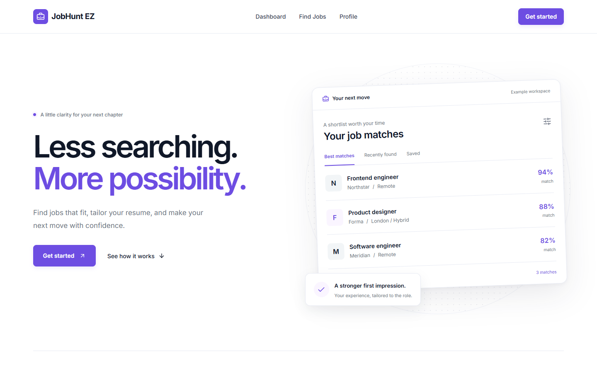
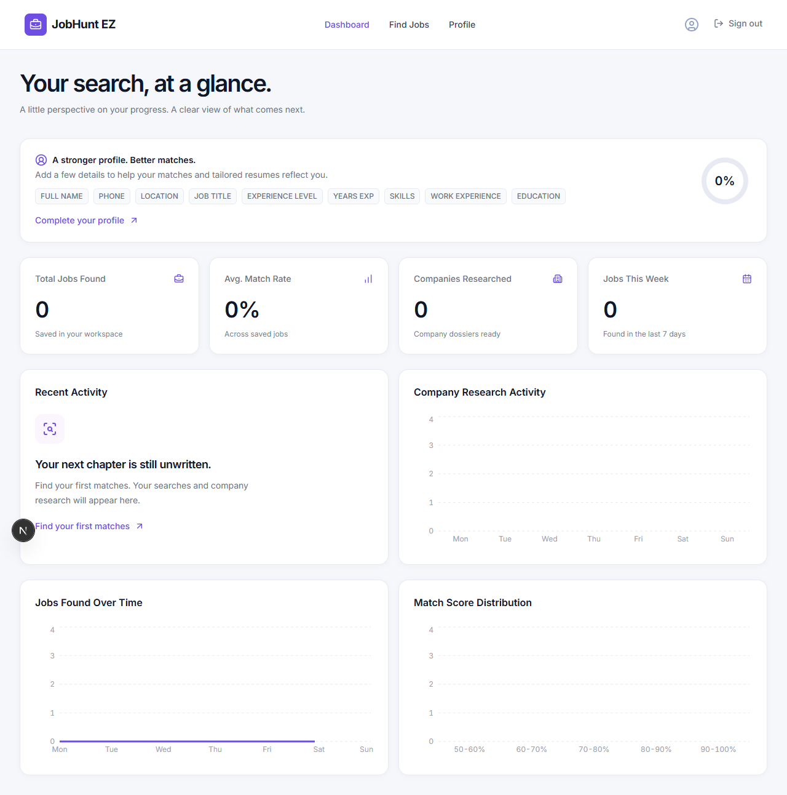

# JobHunt EZ

A full-stack job-search assistant that brings employer listings, AI matching, resume preparation, and company research into one workspace.

Built with **Next.js 16, React 19, NestJS 11, TypeScript, and PostgreSQL** in a **pnpm workspace**. One Node process serves the UI and API.



## What it does

- **Find relevant openings:** discover jobs from public Greenhouse, Lever, Ashby, SmartRecruiters, and Workable sources, with optional aggregator connections.
- **Search on your terms:** save roles, countries, cities, and remote preferences; filter by publication date and match score.
- **Understand the fit:** compare jobs against your profile using Gemini, OpenAI, or Groq. Listings stay saved as **Match pending** when scoring is unavailable.
- **Prepare to apply:** upload a PDF, extract profile details, generate a tailored resume, and research companies.
- **Track your progress:** review saved-job statistics and recent search/research activity.
- **Keep control:** applications open the original employer or job listing; the app does not apply automatically.

<details>
<summary>View the dashboard</summary>



This screenshot uses an empty temporary test account. The homepage preview uses clearly labeled illustrative data.

</details>

## Engineering decisions

| Decision | Why it matters |
| --- | --- |
| Modular monolith | One deployment, with distinct frontend, API, and shared-contract boundaries |
| User-scoped repository | Ownership checks and parameterized queries protect profiles, jobs, and files |
| Private resume storage | PDF downloads require authentication; resumes are never public assets |
| Save before AI scoring | Provider outages and usage limits do not discard discovered jobs |
| Employer-first deduplication | Direct listing metadata takes precedence over aggregator duplicates |
| Atomic admission limits | PostgreSQL coordinates per-user and deployment-wide AI allowances |
| Explicit provider selection | A failed request does not silently spend another provider's credits |

Authentication includes email/password, optional Google/GitHub OAuth, hashed expiring sessions, and production email verification. API writes enforce the configured origin; host and trusted-proxy validation run before page/API routing.

## Run locally

Requires **Node.js 22.12+**, **pnpm 10.34.6**, and **Docker Desktop** or an existing **PostgreSQL 17** database.

```sh
pnpm install --frozen-lockfile
```

Copy `.env.example` to `.env.local`, start Docker Desktop, then run:

```sh
pnpm dev
```

Open [localhost:3000](http://localhost:3000) and create an account. The development runner starts the included local database if needed, applies migrations, and serves the app on one port.

The default local configuration supports signup without sending email. Add `GEMINI_API_KEY` for AI features; the initial provider is Gemini. Employer ATS reads do not require an aggregator key. In Profile, add a supported employer career URL and a relevant role/location to try direct discovery. Optional provider keys expand discovery coverage.

For email verification, OAuth, alternative AI providers, job-source connections, and deployment, see the [setup guide](docs/setup.md).

## Project structure

```text
apps/web/          Next.js pages, components, and thin Server Actions
apps/api/          NestJS modules, business workflows, migrations, and storage
packages/shared/   Framework-independent contracts and pure helpers
scripts/           Development and production build runners
tests/             Unit and PostgreSQL/HTTP integration tests
```

NestJS owns `/api/*` and delegates page requests to Next.js. Business logic and database access stay in the API; secrets stay server-side. See [architecture details](docs/architecture.md) and the [discovery design](docs/discovery.md).

## Verification

```sh
pnpm test
pnpm typecheck
pnpm lint
pnpm build
```

The unit suite covers authentication, ownership, private PDF storage, discovery normalization and deduplication, geographic routing, AI failures, and quota behavior. The latest local run on October 14, 2026 passed **67 tests**. The frontend also passed type checking, lint, production build, and desktop/mobile browser checks.

`pnpm test:integration` exercises PostgreSQL, HTTP routes, profile writes, private storage, and authentication. Run it against a dedicated test database and running test instance; see the [setup guide](docs/setup.md#build-and-checks).

## Scope and limitations

- Job availability depends on each source's coverage and access restrictions. Selecting a country does not guarantee listings.
- AI output needs review. Unknown posting dates, remote eligibility, and pending match scores remain explicit.
- AI and optional browser services may incur provider charges. Paid workflows have shared application limits.
- Production needs HTTPS, configured email delivery, PostgreSQL, and persistent private storage. This custom server requires a persistent Node host.
- The project does not include automatic applications, scheduling, or notifications.
